# ORCA screenshots

Every screen below was captured from a local development build at 1440 px wide (390 px for mobile), using a disposable workspace and illustrative records. No customer data is included.

The gallery follows the product workflow: sign in, run the workspace, sell, bill, collect, automate, administer, and hand the customer their own view.

**Jump to:** [Start here](#start-here) · [Daily workspace](#daily-workspace) · [Sell](#sell) · [Bill and collect](#bill-and-collect) · [Automate](#automate) · [Admin](#admin) · [Customer experience](#customer-experience) · [Mobile](#mobile)

## Start here

The public entry point. Sign in, create a workspace, or switch to the customer portal. There is no demo workspace, sample business, or browser-local fallback behind this screen.

## Daily workspace

**Overview.** Monthly recurring revenue, collections this month, active subscriptions, open receivables, billing pipeline health, recent invoices, and renewals that need attention.

<table>
  <tr>
    <td width="50%" valign="top">
      
       
      <strong>Reports.</strong> Revenue, invoicing, collections, and receivables each use the correct date basis. Invoice reports use issue dates; collections use payment dates. Export the selected report as CSV.
    </td>
    <td width="50%" valign="top">
      
       
      <strong>Copilot.</strong> Search records, explain an invoice, preview the next bill, or prepare a supported action. A proposal executes only after an ORCA approval rechecks access and record versions.
    </td>
  </tr>
</table>

## Sell

<table>
  <tr>
    <td width="50%" valign="top">
      <a href="assets/screenshots/customers.webp">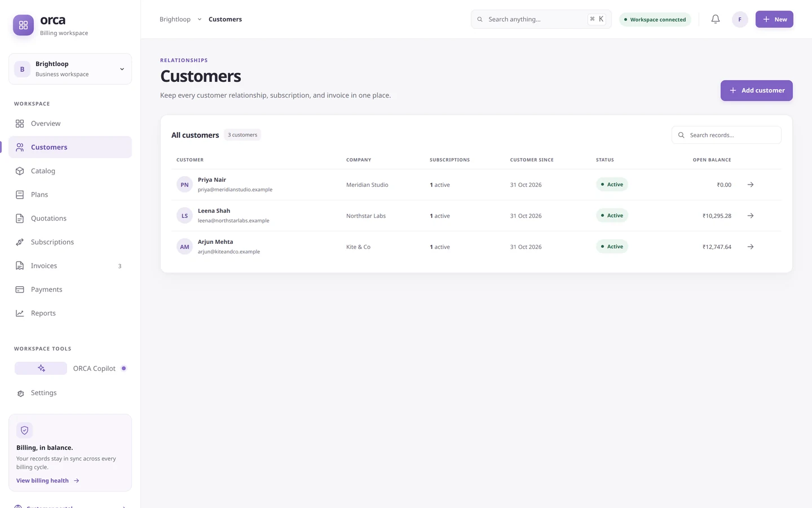</a>
       
      <strong>Customers.</strong> Each relationship keeps its subscriptions and open balance together. Customer records never cross a business boundary.
    </td>
    <td width="50%" valign="top">
      <a href="assets/screenshots/catalog.webp">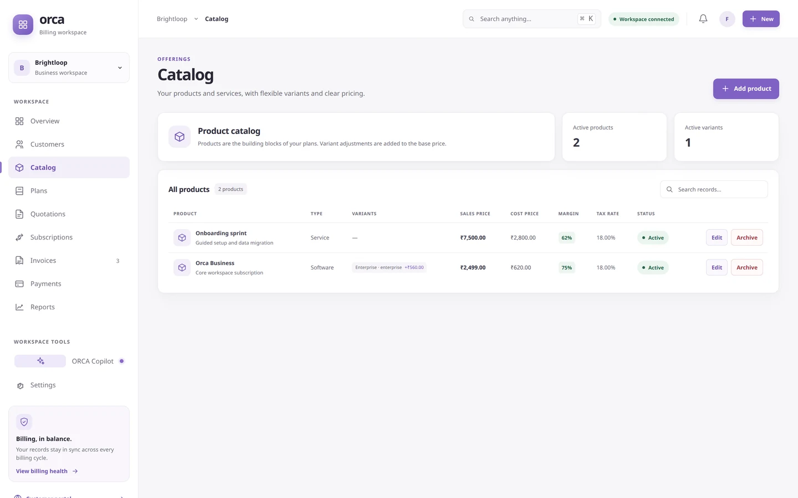</a>
       
      <strong>Catalog.</strong> Products and services with optional variants, sales and cost prices, margin, tax rate, and soft archive. Archived terms stay on existing subscriptions.
    </td>
  </tr>
  <tr>
    <td width="50%" valign="top">
      <a href="assets/screenshots/plans.webp">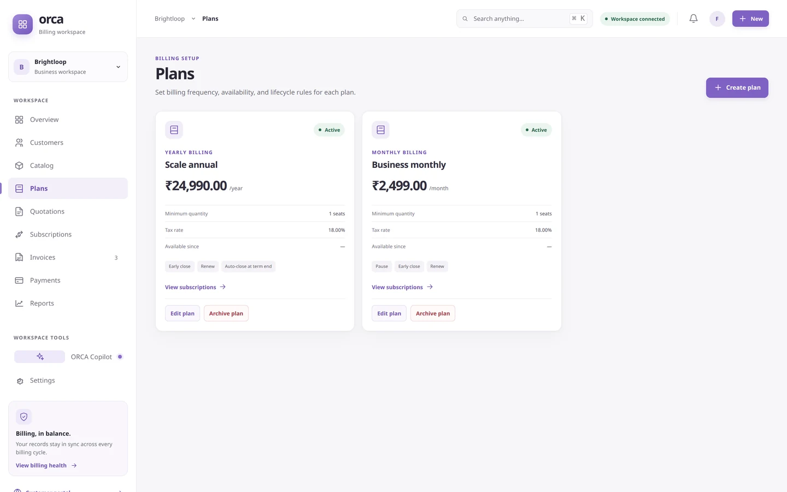</a>
       
      <strong>Plans.</strong> Billing frequency, price, minimum seats, tax, and the lifecycle rules a plan allows: pause, early close, renew, or auto-close at term end.
    </td>
    <td width="50%" valign="top">
      <a href="assets/screenshots/quotations.webp">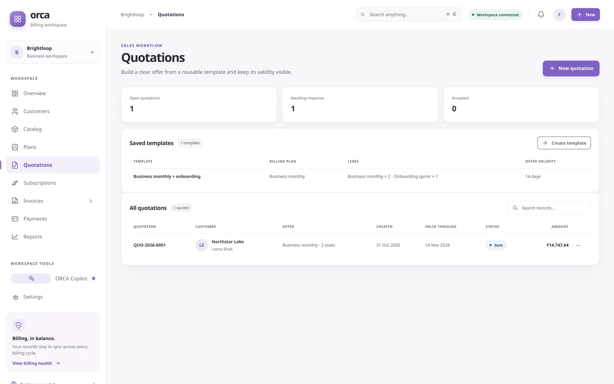</a>
       
      <strong>Quotations.</strong> Reusable templates and customer offers with visible validity, status, seats, and totals. A customer accepts the offer from the portal.
    </td>
  </tr>
</table>

<a href="assets/screenshots/subscriptions.webp">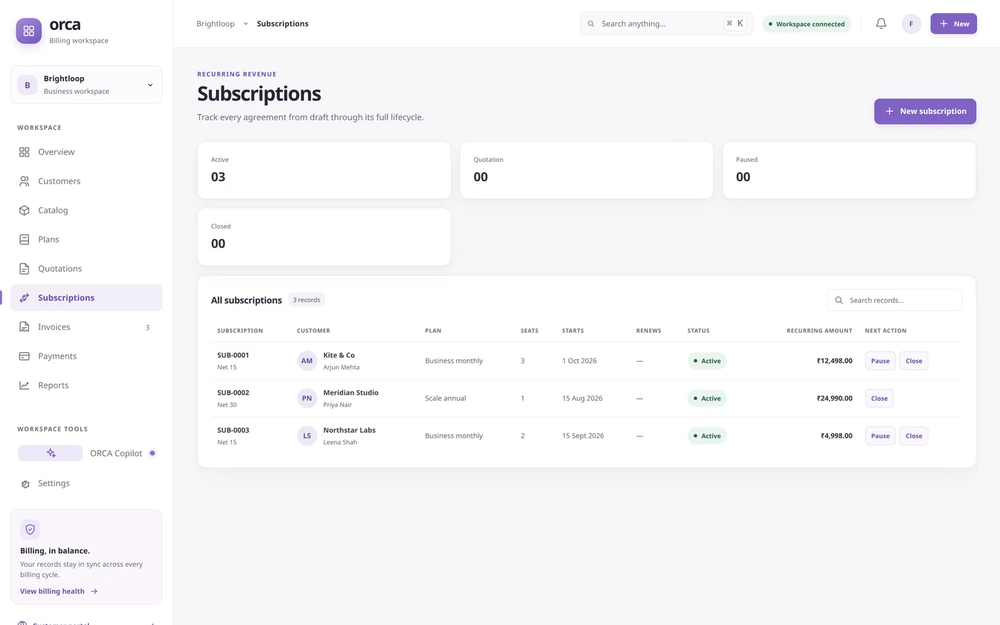</a>

**Subscriptions.** Draft → quotation → confirmed → active → paused or closed. Each row shows the plan, seats, start date, recurring amount, and only the actions that are valid for its current state and plan policy.

## Bill and collect

<a href="assets/screenshots/invoices.webp">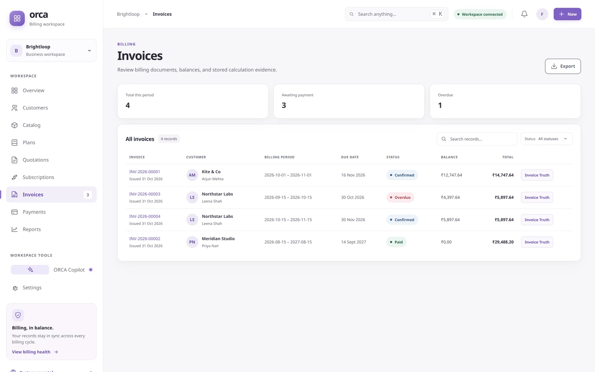</a>

**Invoices.** The invoice register keeps the billing period, due date, status, outstanding balance, and total visible, with a direct route into the stored evidence for every invoice.

<a href="assets/screenshots/invoice-truth.webp">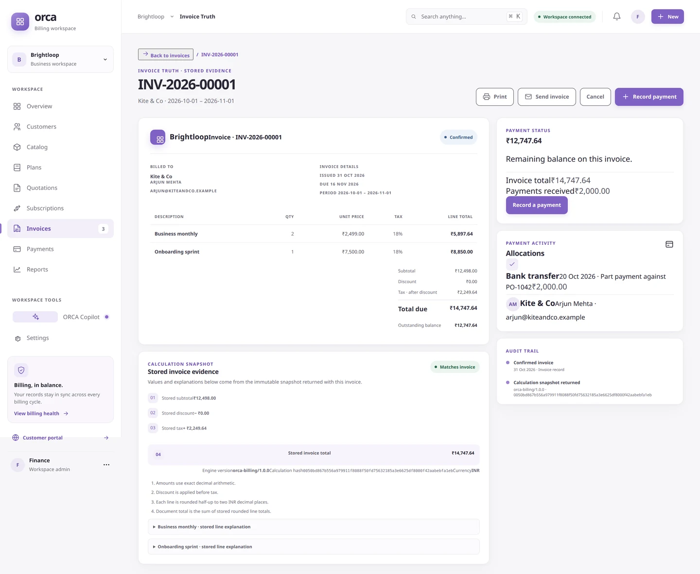</a>

**Invoice Truth.** Line descriptions, quantities, unit prices, tax, subtotal, discount, tax after discount, amount due, payment allocations, and an audit trail. The calculation snapshot records the exact stored inputs, the engine version, and a canonical hash. The browser does not recompute the authoritative total.

<a href="assets/screenshots/payments.webp">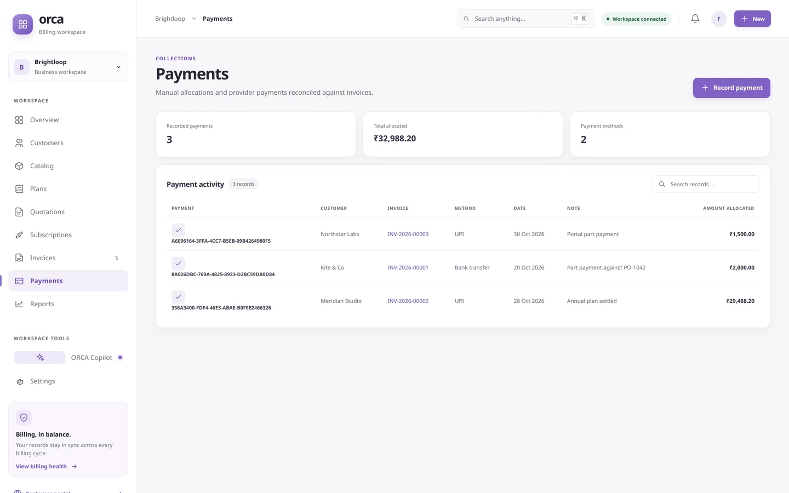</a>

**Payments.** Manual and provider payments are reconciled against invoices, with method, date, note, and allocated amount. Partial payments leave the remaining balance visible. A Stripe browser return never marks an invoice paid; only a verified, idempotent webhook records payment.

## Automate

The Copilot screen above is the built-in assistant. External MCP clients use the same typed domain tools through OAuth discovery, PKCE, scoped grants, and revocation in **Settings → External MCP**. Both paths are read/propose by default; neither gets unrestricted SQL access, and neither bypasses approval.

## Admin

<table>
  <tr>
    <td width="50%" valign="top">
      <a href="assets/screenshots/settings.webp">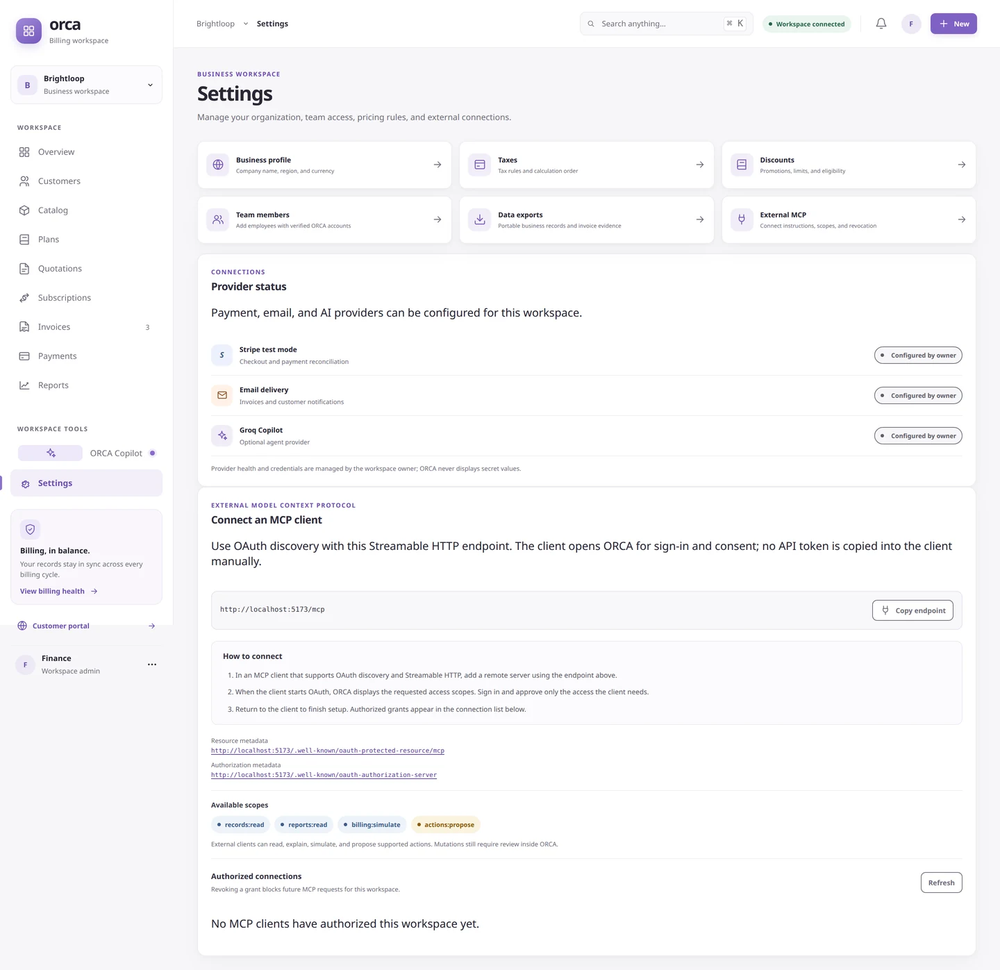</a>
       
      <strong>Settings.</strong> Business profile, taxes, discounts, team access, exports, provider status, and the MCP OAuth endpoint with discovery metadata, scopes, and authorized connections.
    </td>
    <td width="50%" valign="top">
      <a href="assets/screenshots/discounts.webp">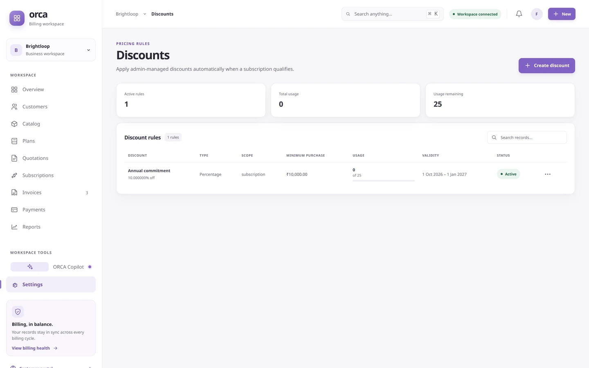</a>
       
      <strong>Discounts.</strong> Fixed or percentage rules with product or subscription scope, minimum purchase and quantity, maximum uses, and a validity window. Eligibility is applied before tax.
    </td>
  </tr>
  <tr>
    <td width="50%" valign="top">
      <a href="assets/screenshots/taxes.webp">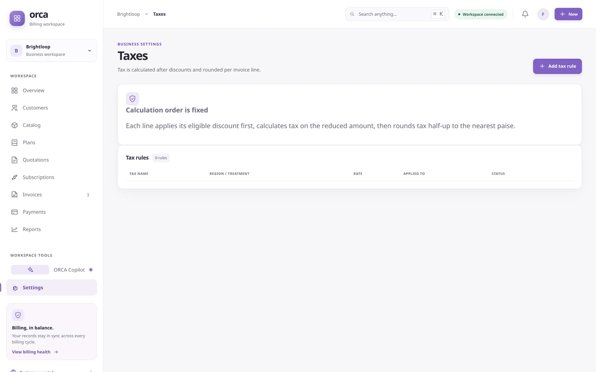</a>
       
      <strong>Taxes.</strong> The calculation order is fixed: each line applies its eligible discount first, calculates tax on the reduced amount, then rounds tax half-up per line.
    </td>
    <td width="50%" valign="top">
      <a href="assets/screenshots/team.webp">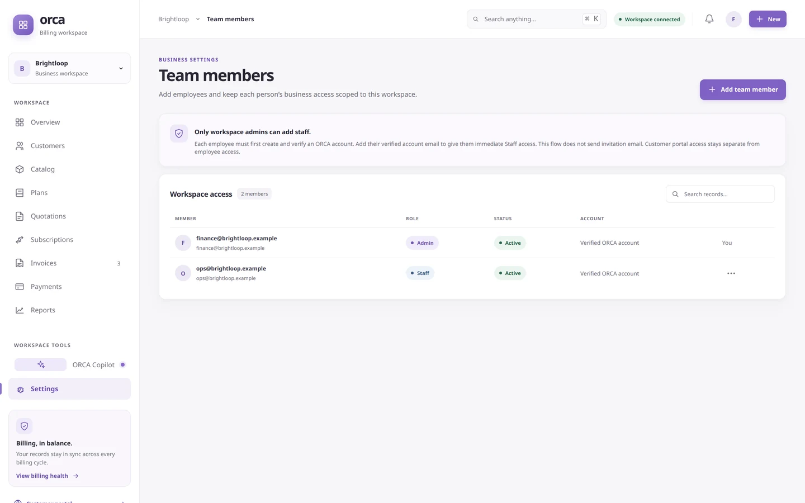</a>
       
      <strong>Team members.</strong> Admin-only staff access for existing ORCA accounts. Customer portal access stays separate from employee access, and no invitation email is implied.
    </td>
  </tr>
</table>

<a href="assets/screenshots/exports.webp">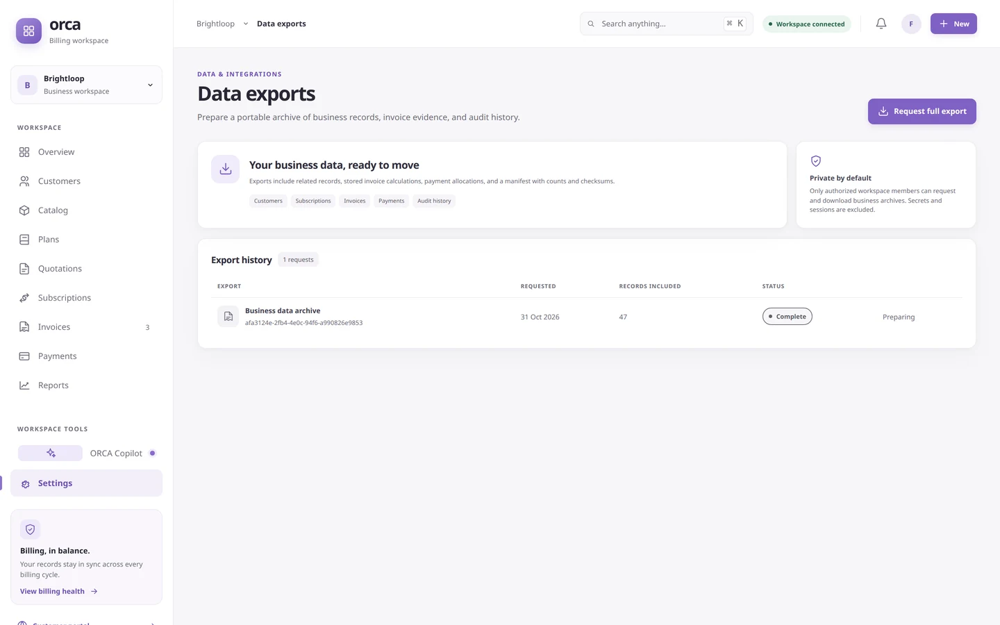</a>

**Data exports.** A full business archive brings related records, stored invoice calculations, payment allocations, a manifest, and checksums. Exports are private to authorized workspace members; secrets and sessions are excluded.

## Customer experience

**Customer portal.** A signed-in customer sees only their own account: offers to accept, subscriptions to pause when the plan allows it, invoices with balances, and online payment where configured. Staff and customer sessions are separate.

## Mobile

<table>
  <tr>
    <td width="50%" valign="top">
      <a href="assets/screenshots/mobile-overview.webp">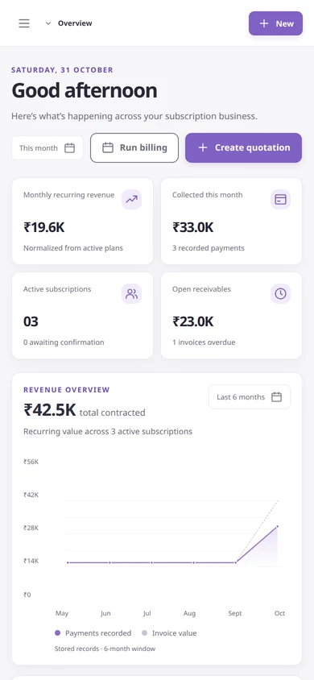</a>
       
      <strong>Workspace on mobile.</strong> The same records and actions at 390 × 844, with no horizontal overflow.
    </td>
    <td width="50%" valign="top">
      <a href="assets/screenshots/mobile-customer-portal.webp">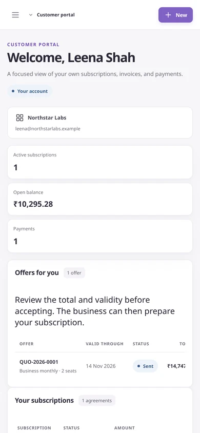</a>
       
      <strong>Portal on mobile.</strong> The customer view stays usable on a small screen.
    </td>
  </tr>
</table>

---

These captures show the current development UI, including work-in-progress copy in a few places. The provider rows in Settings reflect local configuration, not proof of live Stripe, Resend, or Groq delivery. See the [requirements matrix](requirements.md) for what is verified and what remains open.
