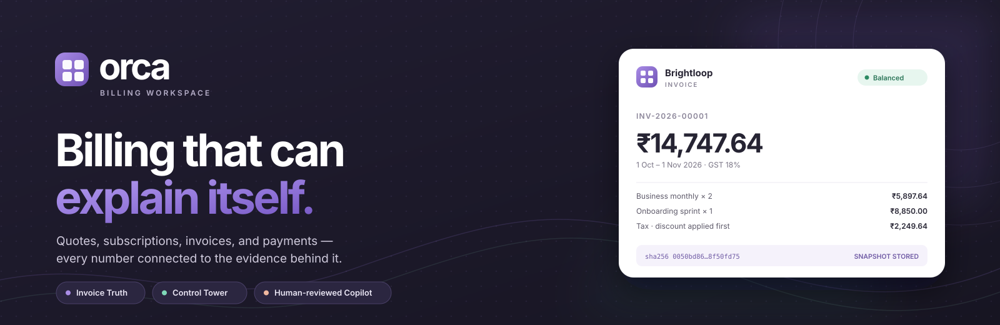
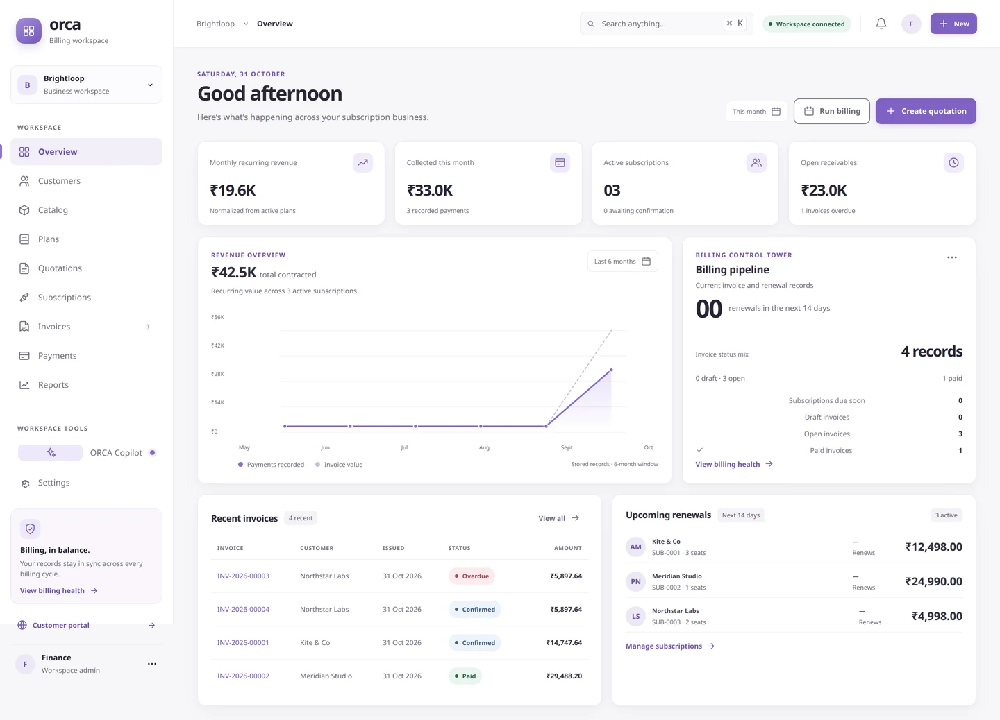
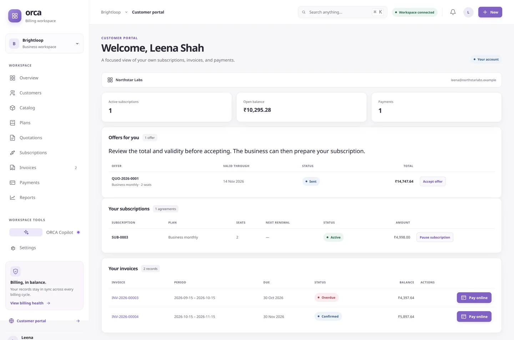
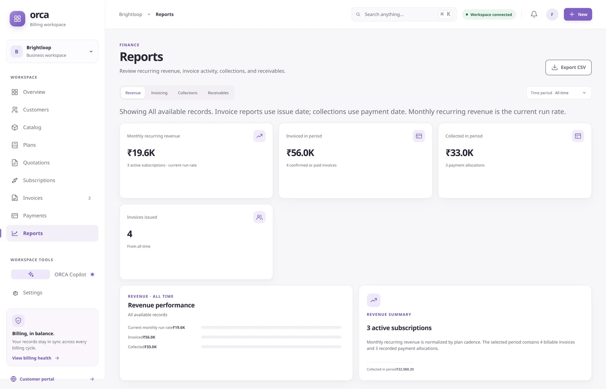
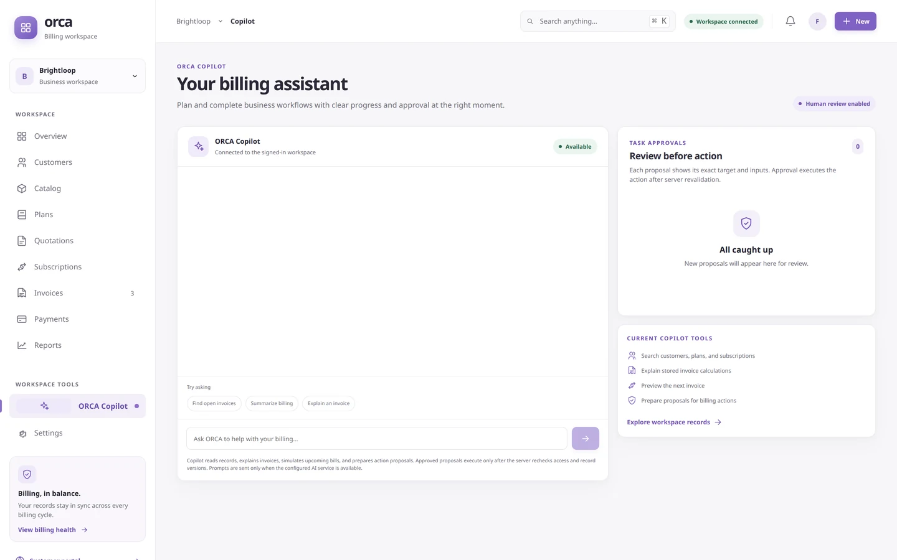
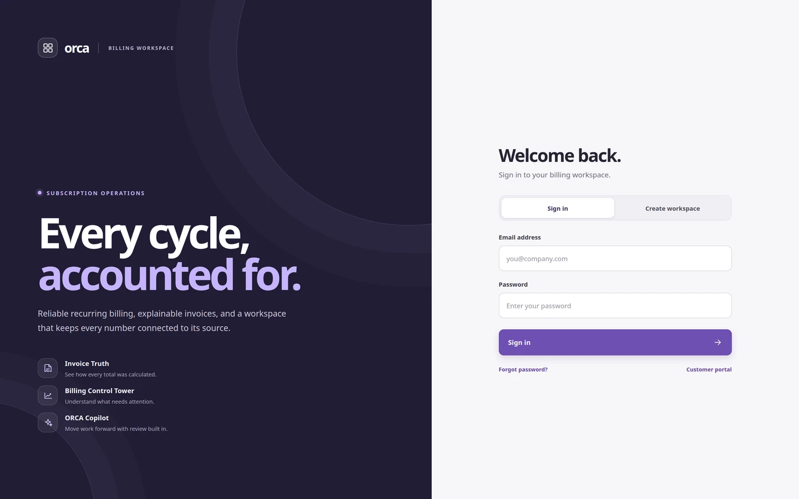
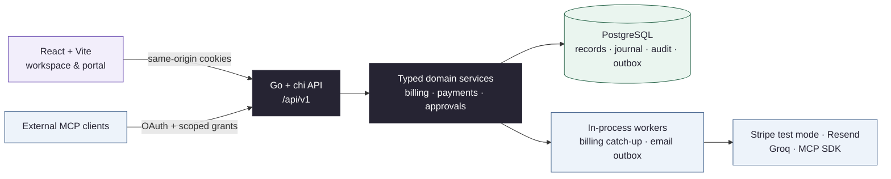

<div align="center">
  
</div>

<h1 align="center">ORCA</h1>

<p align="center">
  <strong>Subscription billing that can explain itself.</strong><br />
  Quotes, renewals, invoices, payments, and approvals — with the evidence still attached.
</p>

<p align="center">
  
  
  
  
  
</p>

<p align="center">
  <a href="https://orca-orcin.vercel.app"><strong>Hosted frontend ↗</strong></a> ·
  <a href="#a-quick-tour">Tour</a> ·
  <a href="#what-is-inside">Features</a> ·
  <a href="#run-orca-locally">Run locally</a> ·
  <a href="#how-orca-fits-together">Architecture</a> ·
  <a href="docs/screenshots.md">Every screen</a> ·
  <a href="docs/index.md">Docs</a> ·
  <a href="docs/requirements.md">Acceptance matrix</a>
</p>

> [!IMPORTANT]
> **Open ORCA:** [orca-orcin.vercel.app](https://orca-orcin.vercel.app). The Vercel frontend and VPS API are live; [the API health route](https://orca-orcin.vercel.app/api/v1/health) returns the PostgreSQL-backed service status.
> ORCA is a hackathon MVP, not production billing software. We didn't have the budget to fund an email provider for this build; email-dependent actions show a clear explanation and write no unusable records. Stripe Checkout is not configured, and several acceptance checks remain open. See the [acceptance matrix](docs/requirements.md).

## The question behind ORCA

Every billing team has had this conversation:

> **Customer:** “Why is this invoice ₹14,747.64?”
>
> **Finance:** “Let me check.” *Three tabs, one spreadsheet, and two Slack threads later…*

ORCA is built so the invoice already knows the answer.

It follows a subscription from product and plan setup through a reusable offer, customer acceptance, billing, payment, and finance review. The point is not another invoice form. The point is being able to prove **what was billed, why it was billed, and what is still owed** — without reconstructing the month from memory.

## Three ideas, one workspace

| Idea | What it changes |
|---|---|
| **Invoice Truth** | Every invoice keeps its stored line inputs, discount and tax steps, billing period, calculation-engine version, and canonical hash. A language model never invents or owns an authoritative total. |
| **Billing Control Tower** | The workspace shows measured billing and integrity data: drafts, open and overdue balances, journal balance, invoice-hash checks, and the next renewals that need attention. |
| **Human-reviewed automation** | Copilot and external MCP clients can search, explain, simulate, and propose. Consequential actions stop for an ORCA review bound to the exact target, inputs, and record versions. |

These are deliberate product choices. Period identity is enforced in PostgreSQL, billing catches up after downtime, and a finalized invoice keeps the inputs used at the time. ORCA does not claim broader billing coverage than established platforms; it makes the resulting evidence easier to inspect.

## A quick tour

<a href="docs/assets/screenshots/overview.webp"></a>

<p align="center"><sub><strong>The morning view.</strong> Revenue, collections, receivables, billing health, recent invoices, and renewals — one calm screen.</sub></p>

<table>
  <tr>
    <td width="50%" valign="top">
      <a href="docs/assets/screenshots/customer-portal.webp"></a>
      <br />
      <sub><strong>A real customer portal.</strong> Customers accept offers, pause eligible plans, and pay their own invoices — without seeing anyone else’s records.</sub>
    </td>
    <td width="50%" valign="top">
      <a href="docs/assets/screenshots/reports.webp"></a>
      <br />
      <sub><strong>Finance can see the whole picture.</strong> Invoice reports use issue dates; collections use payment dates. No blended clock, no mystery totals.</sub>
    </td>
  </tr>
  <tr>
    <td width="50%" valign="top">
      <a href="docs/assets/screenshots/copilot.webp"></a>
      <br />
      <sub><strong>Copilot asks before it acts.</strong> It can look, explain, and prepare a proposal. Approval rechecks access and record versions before anything changes.</sub>
    </td>
    <td width="50%" valign="top">
      <a href="docs/assets/screenshots/sign-in.webp"></a>
      <br />
      <sub><strong>No secret demo door.</strong> Sign in or create a workspace from the first screen. There is no demo workspace, seed data, or browser-local business store.</sub>
    </td>
  </tr>
</table>

<p align="center">
  <sub>Want the full set? <a href="docs/screenshots.md"><strong>See every screen, including mobile →</strong></a></sub>
</p>

## What is inside

| Area | What you can do |
|---|---|
| **Sell** | Manage customers, a product catalog with variants, daily-to-yearly plans, reusable quotation templates, customer offer acceptance, and subscriptions from Draft → Quotation → Confirmed → Active → Closed. Pause, resume, early-close, and renew only when the plan allows it. |
| **Bill** | Generate recurring draft invoices with catch-up after downtime, unique period identity, and persisted cursors. Invoice Truth stores exact decimal inputs, discount-before-tax ordering, half-up line rounding, an explanation, the engine version, and a canonical hash. |
| **Get paid** | Record manual or partial payments against confirmed invoices, settle balances, post a balanced journal, track receivables and overdue balances, and start Stripe Checkout in test mode. A browser return never marks an invoice paid; only a verified, idempotent webhook records payment. |
| **Understand** | Review revenue, invoicing, collections, and receivables with time filters and measured invoice/journal integrity. Export report data as CSV, or request a private ZIP with related JSON/CSV records, printable invoice HTML, a manifest, and checksums. |
| **Automate safely** | Ask Copilot to search records, explain an invoice, preview the next bill, or prepare supported billing actions. External clients connect over Streamable HTTP MCP with OAuth discovery, PKCE, scoped grants, and revocation. Both are read/propose by default; execution still requires ORCA approval. |
| **Operate** | Keep admin, staff, and customer roles tenant-scoped; use revocable server-side sessions, CSRF protection, audit records, a transactional outbox, team access, and admin-only settings. |

The browser never decides who owns a record or whether an invoice is paid. Authorization, calculations, payment reconciliation, and business writes are enforced by the Go API and PostgreSQL.

## How ORCA fits together



- **Frontend:** React 18, TypeScript, Vite, accessible custom controls, and responsive CSS.
- **Backend:** Go, chi, pgx, Goose migrations, `shopspring/decimal` for money, and the official Go MCP SDK.
- **Data integrity:** PostgreSQL transactions, unique billing-period identities, stored invoice snapshots, payment allocations, journal entries, audit records, and the outbox.
- **Sessions:** server-side revocable sessions in PostgreSQL, HTTP-only cookies, CSRF checks, and role/tenant authorization in the API.
- **Trust boundary:** Copilot and MCP call typed domain tools. Neither receives unrestricted SQL access, and neither can bypass an ORCA approval.

## Run ORCA locally

### You’ll need

- **Go 1.27.1** — the version declared in [`backend/go.mod`](backend/go.mod)
- **Node.js 20+** and npm
- **PostgreSQL 15+** with a role that can run migrations
- Optional provider keys if you want to exercise email, Stripe, or Groq

### Three commands

```sh
cp .env.example .env
# Point DATABASE_URL at the PostgreSQL database you control.

npm ci --prefix frontend
make dev
```

Open **[http://localhost:5173](http://localhost:5173)** and create an account. Vite proxies `/api`, `/mcp`, and `/.well-known` to the local Go API, so browser calls stay same-origin. Goose applies `backend/migrations/` automatically when the API starts.

In local development, signup verifies the account automatically, so you can exercise the normal flow without an email provider. There is **no demo workspace, sample business data, file-store fallback, or writable browser-only data**. Create a disposable account and use its PostgreSQL-backed records.

<details>
<summary><strong>Optional providers</strong> — core local workflows do not need them</summary>

<br />

Provider credentials belong in the ignored root `.env` for local work, or in a secret manager for hosting. Never commit them.

| Variable | Purpose |
|---|---|
| `GROQ_API_KEY` | Enables Copilot calls; `GROQ_MODEL` defaults to `openai/gpt-oss-120b` |
| `STRIPE_SECRET_KEY` | Enables Checkout; use an `sk_test_…` key for the current test-mode integration |
| `STRIPE_WEBHOOK_SECRET` | Verifies `POST /api/v1/webhooks/stripe` signatures |
| `RESEND_API_KEY` | Email provider credential; end-to-end delivery still needs verification |
| `EMAIL_FROM` | Verified sender for provider email |

Stripe’s browser return page does not mark an invoice paid. Only a verified, idempotent webhook records a payment. See the [integration contract](docs/integrations.md) and [security contract](docs/security.md).

</details>

### Useful commands

| Command | What it does |
|---|---|
| `make dev` | Runs the Go API and Vite together |
| `make api` / `make web` | Runs either process on its own |
| `make test` | Go unit and database integration tests |
| `make verify` | Tests, race detector, vet, TypeScript, lint alias, and production build |

Database-backed tests use a disposable schema and leave the shared database unchanged. See [testing](docs/testing.md) for the evidence model.

## Verify changes

```sh
make verify
```

This runs Go tests, the Go race detector, `go vet`, TypeScript checking, the current lint alias, and a Vite production build. `npm run lint` currently aliases TypeScript checking; ESLint is not configured. Add the smallest meaningful check for any financial, security, or workflow change.

## What still needs work

ORCA is deliberately honest about the finish line. The remaining acceptance work includes:

- Clean-schema PostgreSQL and sustained concurrency checks for the billing worker.
- Broader subscription, discount, and payment boundary coverage.
- Complete Copilot action coverage and restart-safe agent runs.
- Durable export jobs and periodic archive cleanup.
- Credit notes, reversals for paid invoices, and separately identified prorated adjustments.
- Live Resend delivery, a real Stripe test-mode checkout, and full Groq/MCP client verification.
- Full role-based browser acceptance and measured performance with thousands of records.

The frontend is hosted on Vercel and the Go API runs behind Nginx on the VPS. Production sign-up, email, payment, backup, and end-to-end workflows still need owner-provided provider configuration and acceptance. No demo workspace or sample production records were added. See [deployment](docs/deployment.md) and the [requirements matrix](docs/requirements.md).

## Hackathon team

| Who | Role |
|---|---|
| **Christopher Joshy** | Team Leader |
| **AjithJoshy** | Team Member |

- **Repository:** [ChristopherJoshy/Orca](https://github.com/ChristopherJoshy/Orca)
- **Hosted frontend:** [orca-orcin.vercel.app](https://orca-orcin.vercel.app)
- **Hackathon:** [Odoo Hackathon project 78320](https://hackathon.odoo.com/hackathon/details/78320) *(portal requires participant sign-in)*

## Go deeper

| Start here | Contracts |
|---|---|
| [Documentation index](docs/index.md) | [Billing arithmetic and invariants](docs/billing.md) |
| [Requirements and evidence](docs/requirements.md) | [Security and tenancy](docs/security.md) |
| [Architecture](docs/architecture.md) | [Copilot and approvals](docs/agents.md) |
| [Local development](docs/development.md) | [External MCP](docs/mcp.md) |
| [Testing](docs/testing.md) | [Exports](docs/exports.md) |
| [Every screen](docs/screenshots.md) | [OpenAPI 3.1](docs/api/openapi.yaml) |

Contributor rules live in [AGENTS.md](AGENTS.md). Product decisions, mistakes, and dated verification history are recorded in [history](docs/history.md) and [mistakes](docs/mistakes.md).

<p align="center">
  <sub>Built with Go, React, PostgreSQL, and a strong preference for receipts.</sub>
</p>
