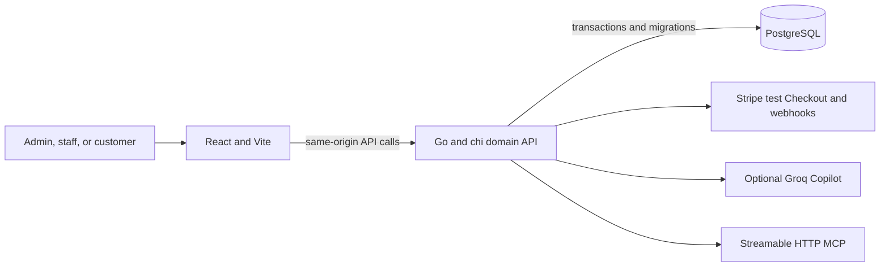

# ORCA

**Know what billed, why it billed, and what is still owed.**

ORCA is a subscription and recurring-billing workspace for teams that need reliable renewals, explainable invoices, and clear receivables. It follows a subscription from product and plan setup through reusable offers that customers can accept, staff conversion, billing, payment, and finance review.

> **Project status:** Working local MVP for the Odoo Hackathon. Provider delivery, durable scheduling, full agent coverage, performance targets, and production hosting still need verification. ORCA is not production-ready billing software; see the [acceptance matrix](docs/requirements.md) for implementation evidence and open work.

## The product idea

Brightloop's billing pain is not just that invoices are created by hand. The team cannot prove why a total changed, whether every renewal was billed exactly once, or how much cash is still outstanding. ORCA makes those questions part of the product.

The design bet is **visible billing integrity**:

- **Invoice Truth:** show the stored line inputs, discount and tax steps, billing period, calculation version, and hash behind an invoice. The model never invents or calculates authoritative totals.
- **Billing Control Tower:** show measured billing and integrity data from the workspace so a finance lead can review drafts, overdue balances, journal balance, and invoice-hash checks.
- **Human-reviewed automation:** Copilot uses scoped domain tools to investigate and prepare actions. Consequential actions require an ORCA review tied to the exact target and inputs.

Subscription lifecycle and invoice automation are established product capabilities across the market. For example, Stripe documents recurring subscriptions, invoice previews, and prorations for subscription and quantity changes. ORCA's focus is to make the resulting billing evidence and operational state inspectable in one small workspace, rather than compete on feature count. See [Stripe subscription updates](https://docs.stripe.com/api/subscriptions/update) and [invoice previews](https://docs.stripe.com/api/invoices/create_preview).

## What works in this build

| Area | Current implementation |
|---|---|
| Accounts and access | Business-admin signup, customer portal access, email verification/reset flows, revocable sessions, CSRF checks, and business-scoped API authorization |
| Products and plans | Product types, sales/cost prices, variants, tax rules, daily/weekly/monthly/yearly plans, minimum quantities, availability dates, and pause/close/renew settings |
| Quotes and subscriptions | Reusable templates preserve a billing plan and optional product line, quantity, exact prices/taxes, and offer validity. Quotations use templates or a plan directly; subscription transitions follow Draft → Quotation → Confirmed → Active → Closed. |
| Recurring billing | A cancellable API worker catches up due subscriptions on startup and every `ORCA_BILLING_INTERVAL` (default `1m`), creating draft invoices from stored billing inputs. Persisted cursors, per-business transactions, and unique period identity prevent repeats and recover after downtime. Email/outbox delivery and durable queue orchestration remain open. |
| Invoice Truth | Stored calculation snapshot, exact decimal amounts, discount-before-tax ordering, half-up line rounding, calculation-engine version, explanation steps, and canonical hash |
| Payments and finance | Manual payment allocations, partial balances, balanced journal entries, invoice status and receivables reports; Stripe Checkout is test-mode only and posts payment from verified webhooks |
| Reporting | Revenue, invoicing, collections, and receivables views with time filters and measured invoice/journal integrity values |
| ORCA Copilot | Optional Groq tool loop for scoped search, reports, invoice explanations, previews, and review proposals for a limited set of billing actions |
| Data exports | Full or filtered private ZIP archives with related JSON/CSV records, printable invoice HTML, manifest, checksums, and download expiry |
| External MCP | Official Go SDK Streamable HTTP endpoint, OAuth discovery, PKCE, scoped grants, ORCA consent, and read/propose tools; mutations still require ORCA review |
| Team workspace | Admins can add an existing verified ORCA account as staff in the current workspace. This flow grants access immediately and does not send invitation email. |

The frontend never decides who owns a record or whether an invoice is paid. Authorization, calculations, payment reconciliation, and business writes are enforced by the Go API and PostgreSQL.

## Hackathon team

- **Christopher Joshy — Team Leader**
- **AjithJoshy — Team Member**

Project registration: [Odoo Hackathon project 78320](https://hackathon.odoo.com/hackathon/details/78320) (the portal requires participant sign-in).

Repository: [ChristopherJoshy/Orca](https://github.com/ChristopherJoshy/Orca)

## Run locally

### Requirements

- Go version declared in `backend/go.mod` (currently Go 1.27.1)
- Node.js 20 or newer and npm
- PostgreSQL 15 or newer, with a role that can run migrations

### Start the app

```sh
cp .env.example .env
# Set DATABASE_URL to a PostgreSQL database you control.
npm ci --prefix frontend
make dev
```

Open [http://localhost:5173](http://localhost:5173). Vite proxies `/api`, `/mcp`, and `/.well-known` to the local Go API. Goose migrations run when the API starts. In local development, signup verifies the account automatically so the normal account flow can be tested without an email provider.

ORCA has no demo workspace, sample business records, file-store fallback, or writable browser-only data. Create a disposable account through the sign-up screen and use its PostgreSQL-backed records. The [local test journey](docs/demo.md) describes a real-account workflow; test credentials are not stored in Git.

### Optional providers

Provider credentials belong in the ignored root `.env` for local work, or the provider's secret manager/environment settings for hosting. Never commit them.

| Variable | Purpose |
|---|---|
| `GROQ_API_KEY` | Enables Copilot calls; `GROQ_MODEL` defaults to `openai/gpt-oss-120b` |
| `STRIPE_SECRET_KEY` | Enables Checkout; use an `sk_test_…` key for the current test-mode integration |
| `STRIPE_WEBHOOK_SECRET` | Verifies `POST /api/v1/webhooks/stripe` signatures |
| `RESEND_API_KEY` | Email provider credential; end-to-end delivery still needs verification |
| `EMAIL_FROM` | Verified sender for provider email |

Stripe's browser return page does not mark an invoice paid. Only a verified, idempotent webhook records a payment. See the [integration contract](docs/integrations.md) and [security contract](docs/security.md).

## Verify changes

```sh
make verify
```

This runs Go unit tests, the race detector, `go vet`, TypeScript checks, the current lint alias, and a Vite production build. `npm run lint` currently aliases TypeScript checking; ESLint is not configured. Database integration tests use a disposable schema; see [testing](docs/testing.md).

## Architecture



- **Frontend:** React 18, TypeScript, Vite, custom accessible controls, and responsive CSS.
- **Backend:** Go, chi, pgx, Goose migrations, exact decimal arithmetic, and the official Go MCP SDK.
- **Financial integrity:** PostgreSQL-backed transactions, unique billing-period identities, immutable invoice evidence, payment allocation, journal, audit, and outbox records.
- **Authentication:** server-side revocable sessions in PostgreSQL, HTTP-only cookies, CSRF checks, and role/tenant authorization in the API.
- **MCP and Copilot:** both call typed domain tools; neither receives unrestricted SQL access.

PostgreSQL's `SKIP LOCKED` supports queue-like multi-consumer work, while unique constraints enforce identities under concurrent writes. Those are sound foundations for future durable billing workers; they do not mean the current MVP already has a multi-worker scheduler. See the [PostgreSQL locking clause](https://www.postgresql.org/docs/current/sql-select.html#SQL-FOR-UPDATE-SHARE) and [constraints](https://www.postgresql.org/docs/current/ddl-constraints.html).

## Current limits and next work

The main unfinished acceptance items are durable recurring billing and downtime recovery, full subscription/discount/payment boundary coverage, complete Copilot action coverage and restart-safe runs, durable export jobs and cleanup, credit notes and prorated adjustments, production email, complete role-based browser acceptance, and measured performance with thousands of records. MCP provider compatibility and Stripe sandbox workflows also need direct end-to-end verification. The [requirements matrix](docs/requirements.md) is the source of truth for scope and status.

Hosting is being prepared separately and has not been performed. Do not treat this repository as production-ready until the database, email, payment, HTTPS, export storage, backups, and worker recovery have been configured and verified. See [deployment](docs/deployment.md).

## Project map

```text
backend/                 Go API, domain logic, migrations, tests
frontend/                React, TypeScript, Vite, responsive workspace
docs/                    Product requirements, architecture, and contracts
commits/                 Numbered implementation and verification records
AGENTS.md                Contributor guide, backend details, and repo rules
Makefile                 Local development and verification commands
readme.md                Product overview and local setup
```

Start with the [documentation index](docs/index.md). Read the [billing](docs/billing.md), [API](docs/api/openapi.yaml), [Copilot](docs/agents.md), [exports](docs/exports.md), [MCP](docs/mcp.md), and [security](docs/security.md) contracts before changing those areas.
